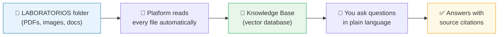
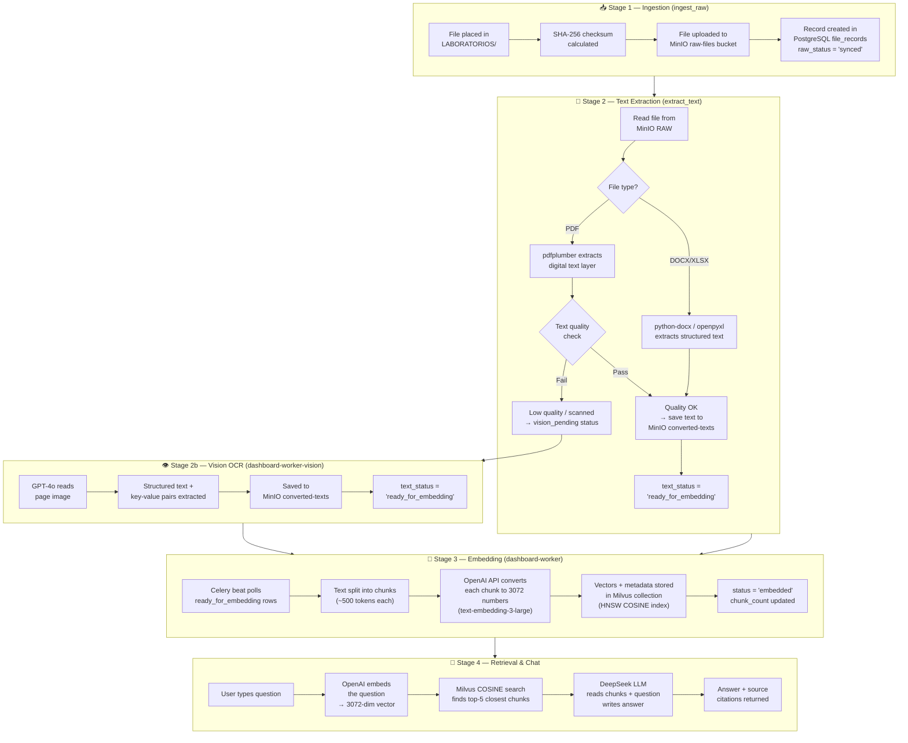
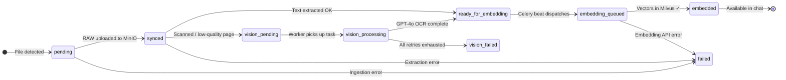
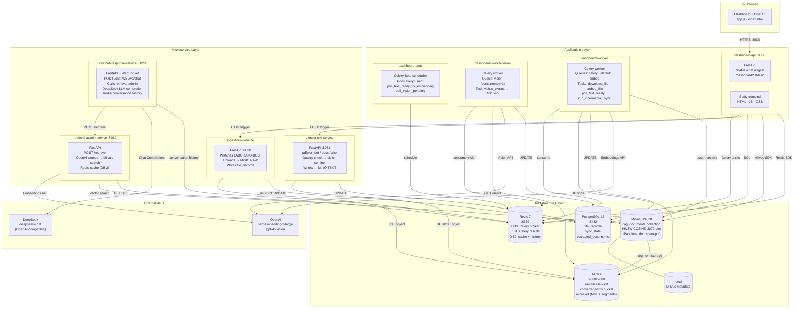
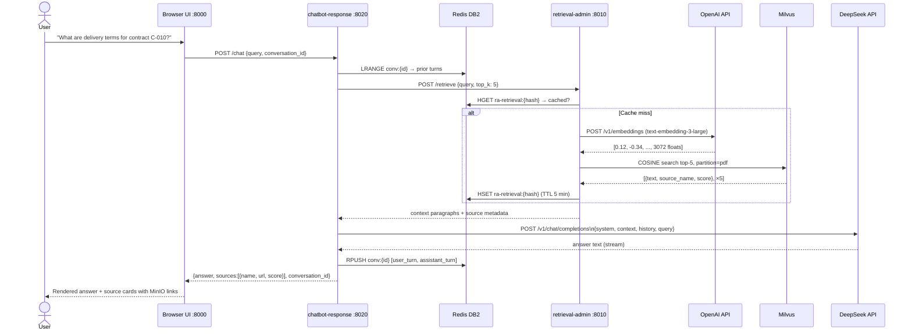
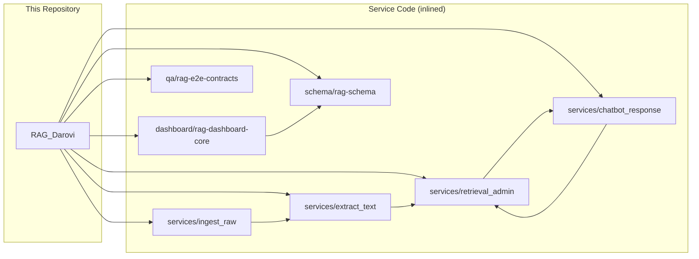

# RAG Darovi — Intelligent Document Assistant for Contract Compliance

> **Automatically reads thousands of pages of procurement contracts — including scanned PDFs and low-quality images — and answers questions about them in plain language.**

Built for [Darovi](https://www.darovi.com.mx/), a Mexican distributor of medicines and health assets operating across CEDIS (Distribution Centers) nationwide. Their government contracts involve enormous volumes of complex documentation: scanned PDFs, package photos, regulatory filings, and signed/stamped forms. This platform makes all of that searchable and conversational.

---

## Table of Contents

1. [What Does This Do? (Non-Technical)](#1-what-does-this-do-non-technical)
2. [Getting Started — Quick Setup](#2-getting-started--quick-setup)
3. [Using the Chat Interface](#3-using-the-chat-interface)
4. [How Documents Become Answers](#4-how-documents-become-answers)
5. [System Architecture (Technical)](#5-system-architecture-technical)
6. [Container Reference](#6-container-reference)
7. [Configuration Reference (Environment Variables)](#7-configuration-reference-environment-variables)
8. [Operations: Backup, Restore, Maintenance](#8-operations-backup-restore-maintenance)
9. [Verification & Testing](#9-verification--testing)
10. [Troubleshooting](#10-troubleshooting)
11. [Glossary](#11-glossary)

---

## 1. What Does This Do? (Non-Technical)

### The Problem

Darovi manages large government procurement contracts regulated by health and vendor compliance rules. Each contract bundle contains:

- **Scanned PDFs** of signed and stamped documents (not machine-readable)
- **Photos of medicine packaging** — thousands of product images
- **Regulatory filings** in formats ranging from Excel to PDF to images

Finding specific information — a delivery date, a technical specification, a regulatory clause — requires manually searching through hundreds of pages. This takes hours per query and is error-prone.

### The Solution

RAG Darovi acts like a very fast, very thorough research assistant that:

1. **Reads every document** placed in a designated folder, including scanned pages and images
2. **Understands the content** at a semantic level — not just keyword search, but meaning
3. **Answers your questions** in plain language, citing the exact documents and pages it used



### Who is this for?

| Role | How they use it |
|------|-----------------|
| **Compliance officers** | "What are the delivery conditions in contract C-010 for IMSS?" |
| **Procurement managers** | "Which contracts mention the antibiotic amoxicillin 500mg?" |
| **Legal reviewers** | "What regulatory clauses apply to cold-chain products?" |
| **Operations staff** | "What is the technical specification for product X?" |

---

## 2. Getting Started — Quick Setup

### Prerequisites

You need installed on your computer:
- **[Docker Desktop](https://www.docker.com/products/docker-desktop/)** (includes Docker Compose)
- **[Git](https://git-scm.com/downloads)**
- ~20 GB free disk space
- A stable internet connection (required for AI APIs during first use)

You also need API keys for:
- **[OpenAI](https://platform.openai.com/api-keys)** — for reading documents and creating embeddings
- **[DeepSeek](https://platform.deepseek.com/)** — for answering questions in the chat

### Step-by-Step Setup

```bash
# 1. Download the project
git clone git@github.com:Quantium/RAG_Darovi.git
cd RAG_Darovi

# 2. Create your configuration file
cp .env.example .env
# Open .env in any text editor and fill in your API keys

# 3. Start the platform (downloads ~3 GB of containers on first run)
docker compose up -d --build

# 4. Wait for everything to be ready (~2-3 minutes)
docker compose ps          # all containers should show "healthy"

# 5. Open the dashboard in your browser
#    → http://localhost:8000
```

### Add Documents

Place your PDF, Word, Excel, or image files in the `LABORATORIOS/` folder at the project root. The system detects them automatically and begins processing.

---

## 3. Using the Chat Interface

Open **http://localhost:8000** in your browser.

### Dashboard View

The dashboard shows real-time pipeline status:

| Counter | Meaning |
|---------|---------|
| **Total Files** | All files detected in LABORATORIOS |
| **Converted** | Files whose text has been extracted (ready to embed) |
| **Embedded** | Files fully indexed and available in the chat |
| **Vision Pending** | Scanned files currently being read by AI vision |

### Chat

1. Click **Chat** in the navigation
2. Type your question in plain language — no special commands needed
3. The system returns:
   - **An answer** synthesized from your documents
   - **Source cards** showing which files and sections were used
   - Clickable links to view the original file in MinIO storage

### Re-Vectorize

If you added many new documents or the vector database was reset, click **Re-Vectorize** (with `X-Dashboard-Confirm: yes`) to re-index everything from existing extracted texts — without re-running OCR or extraction.

---

## 4. How Documents Become Answers

This diagram shows every stage a document passes through, from file detection to appearing as a source in chat.



### File Status State Machine

Every file moves through these states in `file_records.text_status` and `file_records.status`:



---

## 5. System Architecture (Technical)

### Container Communication Map



### Chat Request — Sequence



---

## 6. Container Reference

### Services and Responsibilities

| Container | Port | Source | Role |
|-----------|------|--------|------|
| `dashboard-api` | `8000` | `dashboard/rag-dashboard-core` | Main entrypoint: FastAPI app, static frontend, Celery dispatcher |
| `dashboard-worker` | — | `dashboard/rag-dashboard-core` | Celery worker: `download_file`, `embed_file`, `poll_text_ready_for_embedding`, `run_incremental_sync` |
| `dashboard-worker-vision` | — | `dashboard/rag-dashboard-core` | Dedicated OCR worker: `vision_extract` via GPT-4o (concurrency=1) |
| `dashboard-beat` | — | `dashboard/rag-dashboard-core` | Celery Beat: fires polling tasks every `EMBEDDING_POLL_INTERVAL_SECONDS` |
| `ingest-raw-service` | `8030` | `services/ingest_raw` | Watches `LABORATORIOS/`; uploads binaries to MinIO; creates `file_records` |
| `extract-text-service` | `8031` | `services/extract_text` | Downloads RAW from MinIO; runs pdfplumber/docx/xlsx; quality-checks text; emits vision sentinels; writes to MinIO TEXT |
| `retrieval-admin-service` | `8010` | `services/retrieval_admin` | REST API only (no UI): embeds queries via OpenAI → Milvus COSINE search → Redis cache |
| `chatbot-response-service` | `8020` | `services/chatbot_response` | REST + WebSocket chat: loads conversation history from Redis; calls retrieval-admin; calls DeepSeek for LLM completion |
| `postgres` | `5432` | `postgres:16-alpine` | Relational metadata store |
| `redis` | `6379` | `redis:7-alpine` | Celery broker (DB 0), results (DB 1), retrieval cache + conversation history (DB 2) |
| `minio` | `9000/9001` | `minio/minio` | Object storage: `raw-files`, `converted-texts`, `a-bucket` (Milvus internal segments) |
| `milvus` | `19530` | `milvusdb/milvus:v2.4.21` | Vector database: `rag_documents` collection, HNSW COSINE index (dim=3072) |
| `milvus-etcd` | — | `quay.io/coreos/etcd:v3.5.18` | Milvus collection metadata store |

### Named Volumes (persistent data — survives `docker compose down`)

| Volume | Container | Contains |
|--------|-----------|---------|
| `pgdata` | postgres | All database tables and records |
| `redisdata` | redis | Celery queues (AOF persistence) + conversation cache |
| `miniodata` | minio | Raw files, extracted texts, Milvus vector segments |
| `milvusdata` | milvus | Milvus runtime state |

> **Warning:** `docker compose down -v` (the `-v` flag) **deletes all volumes**, including your vectors and files. Use plain `docker compose down` to stop containers without losing data.

---

## 7. Configuration Reference (Environment Variables)

Copy `.env.example` to `.env` and fill in the required values. The file is gitignored.

### OpenAI — Embeddings + Vision

| Variable | Default | Required | Description |
|----------|---------|----------|-------------|
| `OPENAI_API_KEY` | — | ✅ | Master OpenAI key (used for vision; `EMBED_API_KEY` takes precedence for embeddings) |
| `EMBED_API_KEY` | — | ✅ | OpenAI key used specifically for the embeddings endpoint |
| `EMBED_API_URL` | `https://api.openai.com/v1` | — | Override for OpenAI-compatible embedding APIs |
| `EMBED_MODEL` | `text-embedding-3-large` | — | Embedding model. **Do not change** without recreating the Milvus collection — dimension must match `EMBED_DIM`. See [OpenAI embedding models](https://platform.openai.com/docs/guides/embeddings) |
| `EMBED_DIM` | `3072` | — | Output vector dimension. `text-embedding-3-large` → 3072. `text-embedding-3-small` → 1536. See [embedding dimensions](https://platform.openai.com/docs/guides/embeddings#embedding-models) |
| `EMBED_BATCH_SIZE` | `64` | — | Documents per embedding API call. Reduce if hitting rate limits. |
| `VISION_EXTERNAL_API_KEY` | — | ✅ | OpenAI key for GPT-4o vision calls |
| `VISION_EXTERNAL_MODEL` | `gpt-4o` | — | Vision model for OCR. See [GPT-4o vision](https://platform.openai.com/docs/guides/vision) |
| `VISION_ENABLED` | `true` | — | Set `false` to disable AI vision; only Tesseract OCR fallback will run |
| `VISION_REQUEST_TIMEOUT_S` | `180` | — | Per-request timeout for vision API calls (seconds) |
| `VISION_MAX_IMAGE_MB` | `8` | — | Images larger than this are downscaled to 2048px / JPEG q=85 before sending |
| `VISION_MAX_PAGES_PER_REQUEST` | `1` | — | Pages per GPT-4o call. Keep at 1 to avoid payload limits |
| `VISION_CIRCUIT_BREAKER_THRESHOLD` | `5` | — | Consecutive failures before the [circuit breaker](https://martinfowler.com/bliki/CircuitBreaker.html) opens and falls back to Tesseract |
| `VISION_CIRCUIT_BREAKER_RESET_S` | `300` | — | Seconds before the breaker transitions to half-open for a probe |
| `VISION_FALLBACK_TO_TESSERACT` | `true` | — | Fall back to Tesseract [OCR](https://en.wikipedia.org/wiki/Optical_character_recognition) if vision fails |

### DeepSeek — Chat LLM

| Variable | Default | Required | Description |
|----------|---------|----------|-------------|
| `DEEPSEEK_API_KEY` | — | ✅ | DeepSeek API key. Get one at [platform.deepseek.com](https://platform.deepseek.com). Uses [OpenAI-compatible API](https://api-docs.deepseek.com/) |
| `DEEPSEEK_BASE_URL` | `https://api.deepseek.com/v1/` | — | Base URL for DeepSeek (OpenAI-compatible endpoint) |
| `LLM_PROVIDER` | `deepseek` | — | LLM backend. Currently only `deepseek` is supported. |
| `LLM_MODEL` | `deepseek-chat` | — | Model name. See [DeepSeek models](https://api-docs.deepseek.com/quick_start/pricing) |
| `LLM_API_KEY` | — | ✅ | Same as `DEEPSEEK_API_KEY` (used by generic LLM client) |
| `LLM_BASE_URL` | `https://api.deepseek.com/v1/` | — | Same as `DEEPSEEK_BASE_URL` |

### MinIO — Object Storage

[MinIO](https://min.io/) is an S3-compatible object store that holds all files locally. It runs inside Docker and exposes an API (port 9000) and a browser console (port 9001).

| Variable | Default | Required | Description |
|----------|---------|----------|-------------|
| `MINIO_ENDPOINT` | `localhost:9000` | — | Internal endpoint (for containers, use `minio:9000`) |
| `MINIO_ACCESS_KEY` | `minioadmin` | — | S3 access key |
| `MINIO_SECRET_KEY` | `minioadmin` | — | S3 secret key |
| `MINIO_SECURE` | `false` | — | Set `true` if MinIO is behind HTTPS |
| `MINIO_BUCKET_RAW` | `raw-files` | — | Bucket for original uploaded documents |
| `MINIO_BUCKET_TEXT` | `converted-texts` | — | Bucket for extracted text (markdown format) |
| `MINIO_EXTERNAL_ENDPOINT` | `http://localhost:9000` | — | Browser-accessible URL used to generate [presigned download links](https://min.io/docs/minio/linux/developers/python/API.html#presigned-object-url-methods) shown in chat sources |
| `MINIO_CONSOLE_ENDPOINT` | `http://localhost:9001` | — | MinIO web console URL (used in source card links) |

### PostgreSQL — Relational Metadata

[PostgreSQL 16](https://www.postgresql.org/docs/16/) stores the pipeline state machine for every file. Key table: `file_records`.

| Variable | Default | Required | Description |
|----------|---------|----------|-------------|
| `DATABASE_URL` | `postgresql+asyncpg://...` | — | Async connection string for [SQLAlchemy asyncio](https://docs.sqlalchemy.org/en/20/orm/extensions/asyncio.html) (FastAPI). Driver: [asyncpg](https://github.com/MagicStack/asyncpg) |
| `DATABASE_URL_SYNC` | `postgresql+psycopg2://...` | — | Sync connection string for [Celery](https://docs.celeryq.dev/en/stable/) tasks. Driver: [psycopg2](https://www.psycopg.org/) |

### Redis — Broker, Results, Cache

[Redis 7](https://redis.io/docs/latest/) uses three logical databases on the same instance:

| Variable | Default | DB | Description |
|----------|---------|-----|-------------|
| `REDIS_BROKER_URL` | `redis://localhost:6379/0` | 0 | [Celery message broker](https://docs.celeryq.dev/en/stable/getting-started/backends-and-brokers/redis.html) — holds task queues. **AOF persistence enabled** so queues survive restarts |
| `REDIS_RESULT_URL` | `redis://localhost:6379/1` | 1 | Celery task results backend |
| `REDIS_CACHE_URL` | `redis://localhost:6379/2` | 2 | Retrieval cache (5-min TTL) + conversation history (`conv:{id}` lists) |

### Milvus — Vector Database

[Milvus](https://milvus.io/docs/overview.md) is the vector database that powers semantic search. It stores 3072-dimensional float vectors representing the "meaning" of each text chunk.

| Variable | Default | Required | Description |
|----------|---------|----------|-------------|
| `MILVUS_HOST` | `localhost` | — | Hostname of the Milvus gRPC server |
| `MILVUS_PORT` | `19530` | — | gRPC port |
| `MILVUS_COLLECTION` | `rag_documents` | — | Collection name. Contains partitions: `doc`, `sheet`, `pdf`. Index: [HNSW COSINE](https://arxiv.org/abs/1603.09320), M=16, efConstruction=256, dim=3072 |

> **Changing `EMBED_DIM` or `EMBED_MODEL`?** You must drop and recreate the Milvus collection (use the Re-Vectorize button in the dashboard), then re-run the embedding pipeline. Stored vectors and model dimensions must always match.

### OCR Tuning (Tesseract Fallback)

[Tesseract](https://github.com/tesseract-ocr/tesseract) is the open-source OCR engine used as a fallback when GPT-4o vision is unavailable. Quality thresholds determine whether extracted text is accepted or sent to vision.

| Variable | Default | Description |
|----------|---------|-------------|
| `OCR_LANGUAGE` | `eng` | Tesseract language code. See [language codes](https://tesseract-ocr.github.io/tessdoc/Data-Files.html) |
| `OCR_DPI` | `300` | Image rasterization DPI via [pdf2image](https://github.com/Belval/pdf2image). Higher = better quality but slower |
| `OCR_MIN_TEXT_CHARS` | `40` | Minimum non-whitespace characters required to accept text layer |
| `OCR_MIN_ALPHA_RATIO` | `0.45` | Minimum fraction of alphabetic characters in extracted text |
| `OCR_MAX_SINGLE_CHAR_LINE_RATIO` | `0.6` | Maximum fraction of single-character lines before classifying as garbage |

### API Server

| Variable | Default | Description |
|----------|---------|-------------|
| `API_HOST` | `0.0.0.0` | Bind address for [Uvicorn](https://www.uvicorn.org/) |
| `API_PORT` | `8000` | Listen port |
| `API_KEY` | *(empty)* | If set, all API endpoints require `X-API-Key: <value>` header. Empty = no auth |
| `API_SSL_CERTFILE` | `/etc/rag/certs/cert.pem` | TLS certificate path (optional). See [TLS setup](#https-optional) |
| `API_SSL_KEYFILE` | `/etc/rag/certs/key.pem` | TLS private key path |

---

## 8. Operations: Backup, Restore, Maintenance

### Backup

The backup script saves three artifacts to `backups/YYYYMMDD_HHMMSS/`:

| File | Contents | Size (typical) |
|------|----------|---------------|
| `postgres.sql.gz` | Full database dump with `DROP ... IF EXISTS` | ~500 KB |
| `minio_converted_texts.tar.gz` | All extracted text files | ~50 MB |
| `milvus_vectors.parquet` | All vectors with full metadata (portable parquet format) | ~100 MB+ |
| `minio_raw_files.tar.gz` | Original PDFs/images — only with `--include-raw` | ~4 GB+ |

```bash
# Fast backup — DB + texts + vectors (run after each vectorization session)
./scripts/backup.sh

# Full backup including original files
./scripts/backup.sh --include-raw

# Custom destination
./scripts/backup.sh --dest /mnt/nas/darovi-backups

# Selective backup — only one component
./scripts/backup.sh --only-postgres
./scripts/backup.sh --only-minio
./scripts/backup.sh --only-milvus
```

### Restore

```bash
# Restore from a backup directory (prompts for confirmation, then overwrites data)
./scripts/restore.sh backups/20260524_220000

# Selective restore — only one component from a full backup
./scripts/restore.sh backups/20260524_220000 --only-postgres
./scripts/restore.sh backups/20260524_220000 --only-minio
./scripts/restore.sh backups/20260524_220000 --only-milvus
```

The restore script:
1. Clears existing PostgreSQL data and restores the dump
2. Uploads extracted texts back to MinIO
3. Drops the Milvus collection, recreates the schema, and bulk-inserts all vectors from the parquet

### Scheduled Backups

For automated nightly backups, add to crontab:

```bash
# Every day at 2 AM
0 2 * * * cd /path/to/RAG_Darovi && ./scripts/backup.sh >> logs/backup.log 2>&1
```

### Stack Lifecycle

```bash
make up             # Start all services in background
make down           # Stop all services (data preserved in volumes)
make clean          # Stop services AND delete all volumes (DATA LOSS)
make docker-build   # Rebuild images without restarting

# Rebuild specific service after code change
docker compose up -d --build --no-deps dashboard-api
```

### HTTPS (Optional)

```bash
make tls-certs    # Generates self-signed certs in ./certs/
```

Configure in `.env`:
```env
API_SSL_CERTFILE=/etc/rag/certs/cert.pem
API_SSL_KEYFILE=/etc/rag/certs/key.pem
```

---

## 9. Verification & Testing

### Smoke Check (after `make up`)

```bash
docker compose ps                          # all containers healthy
curl -k https://localhost:8000/status      # {"total_files":N, "embedded":M, ...}
curl http://localhost:8010/health          # {"status":"ok"}
curl http://localhost:8020/health          # {"status":"ok"}
./scripts/verify-multi-repo-local.sh       # full integration check
```

### Test Suites

| Target | What it runs |
|--------|-------------|
| `make qa-dashboard` | `dashboard/rag-dashboard-core` unit suite (pytest) |
| `make qa-services` | Unit suites for all four services |
| `make qa-cross` | Cross-service HTTP contract tests (`qa/rag-e2e-contracts`) |
| `make qa-all` | All three gates in sequence |

Each service has its own `Makefile` that bootstraps a virtualenv:
```bash
cd services/retrieval_admin && make install && make test
```

---

## 10. Troubleshooting

### Files stuck in `embedding_queued`

This usually means the OpenAI API returned `429 Too Many Requests`. The Celery Beat scheduler retries automatically every `EMBEDDING_POLL_INTERVAL_SECONDS` (default: 300s). Check worker logs:

```bash
docker compose logs dashboard-worker --tail=50
```

If you see persistent failures, check `file_records.error_message` in PostgreSQL:

```sql
SELECT name, error_message FROM file_records WHERE text_status = 'embedding_queued' LIMIT 10;
```

### Milvus has 0 vectors after restart

If `milvus_vectors = 0` in the dashboard state but PostgreSQL shows files as `embedded`, the Milvus volume was likely wiped. Use the Re-Vectorize button (or `POST /dashboard/re-vectorize` with header `X-Dashboard-Confirm: yes`) to rebuild from existing extracted texts in MinIO — no API cost, no re-OCR needed.

If you have a recent backup, restore it with `./scripts/restore.sh`.

### `ImportError` on startup

If dashboard-api logs show an `ImportError`, a Python import is referencing a class that was removed. Check the import chain and remove stale references.

### `Permission denied` connecting to Docker

```bash
sudo usermod -aG docker "$USER"
# Log out and back in, or run:
newgrp docker
```

### `retrieval-admin-service` won't start

Check that `LLM_API_KEY` and `LLM_BASE_URL` are set in `.env`. The service uses these for its `/answer` endpoint.

---

## 11. Glossary

| Term | Definition |
|------|-----------|
| **RAG** | [Retrieval-Augmented Generation](https://arxiv.org/abs/2005.11401): an AI technique that retrieves relevant document chunks before generating an answer, instead of relying solely on the LLM's training data |
| **Vector embedding** | A list of numbers (e.g., 3072 floats) that represents the semantic meaning of a text. Similar meanings produce similar vectors. See [OpenAI embeddings guide](https://platform.openai.com/docs/guides/embeddings) |
| **Cosine similarity** | A [distance metric](https://en.wikipedia.org/wiki/Cosine_similarity) between two vectors: 1.0 = identical meaning, 0 = unrelated, -1 = opposite. Used by Milvus to rank search results |
| **HNSW** | [Hierarchical Navigable Small World](https://arxiv.org/abs/1603.09320): a graph-based approximate nearest-neighbor index used by Milvus for fast similarity search at scale |
| **Milvus** | An [open-source vector database](https://milvus.io/docs/overview.md) designed for storing and searching billions of high-dimensional vectors |
| **Celery** | A [distributed task queue](https://docs.celeryq.dev/en/stable/) for Python. Used here to run embedding and OCR jobs asynchronously in background workers |
| **Celery Beat** | The [Celery scheduler](https://docs.celeryq.dev/en/stable/userguide/periodic-tasks.html) that fires periodic tasks (e.g., checking for newly extracted texts every 5 minutes) |
| **MinIO** | An [S3-compatible object store](https://min.io/) that runs locally in Docker. Stores raw files and extracted texts |
| **pdfplumber** | A [Python library](https://github.com/jsvine/pdfplumber) that extracts text from digital (non-scanned) PDFs using the embedded text layer |
| **OCR** | [Optical Character Recognition](https://en.wikipedia.org/wiki/Optical_character_recognition): converting an image of text into machine-readable text |
| **GPT-4o Vision** | OpenAI's [multimodal model](https://platform.openai.com/docs/guides/vision) that can read and interpret images, used here for OCR on scanned documents |
| **Circuit breaker** | A [software pattern](https://martinfowler.com/bliki/CircuitBreaker.html) that stops calling a failing service after repeated errors and retries after a cooldown period |
| **DeepSeek** | A Chinese AI lab providing [OpenAI-compatible chat LLMs](https://api-docs.deepseek.com/). `deepseek-chat` is used for generating answers |
| **LLM** | Large Language Model: an AI model trained on vast text data that can generate human-quality text responses |
| **Presigned URL** | A [time-limited URL](https://min.io/docs/minio/linux/developers/python/API.html#presigned-object-url-methods) that grants temporary access to a MinIO object without authentication |
| **AOF** | [Append-Only File](https://redis.io/docs/latest/operate/oss_and_stack/management/persistence/): Redis persistence mode that logs every write operation so the dataset survives restarts |
| **CEDIS** | Centros de Distribución — Darovi's regional distribution centers across México |

---

## Standard Relationship Diagram



> All service code lives directly in this monorepo (submodules were dissolved in May 2026). Changes to any service are committed directly here.

---

*Documentation maintained by the Quantium engineering team. For issues, open a GitHub Issue.*
