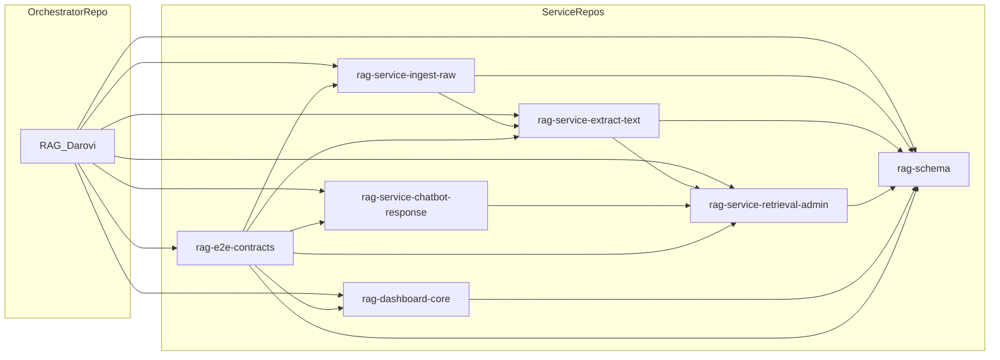

# RAG Darovi (Orchestrator)

This repository is the **local orchestrator** for the RAG Darovi platform. It does not host service code directly: every runtime lives in a dedicated repository and is mounted here through git submodules. The orchestrator owns Docker Compose, environment templates, integration scripts, and the verification gates that exercise the whole multi-repo system end to end.

For the second cleanup history and rationale, see [docs/repo-split/REPO_SPLIT_MAP.md](docs/repo-split/REPO_SPLIT_MAP.md) and [docs/repo-split/VERIFICATION_GATES.md](docs/repo-split/VERIFICATION_GATES.md).

## About the project

Darovi is a corporation that serves medicines and health assets through their CEDIS (Centros de Distribución) across the country (México). Their main clients are government dependencies so their contracts are based on strong regulatory conditions which need to fit into health and goverment vendor compliance. The documentation for each contract is huge and is conformed by images and pdfs. The majority of the images are the photos of the packages of the medicines and assets and a lot of pdfs are just scanned documents with seals and signatures diffucult to identify for a common OCR. 

This project intents to solve the hard work of deep into the documents in order to get information out of it using deep vision, RAG and chatbot LLM. We plan, for a second stage of the project, connect this with the ERP.

## Repositories at a glance

- `services/ingest_raw` -> [Quantium/rag-service-ingest-raw](https://github.com/Quantium/rag-service-ingest-raw)
- `services/extract_text` -> [Quantium/rag-service-extract-text](https://github.com/Quantium/rag-service-extract-text)
- `services/retrieval_admin` -> [Quantium/rag-service-retrieval-admin](https://github.com/Quantium/rag-service-retrieval-admin)
- `services/chatbot_response` -> [Quantium/rag-service-chatbot-response](https://github.com/Quantium/rag-service-chatbot-response)
- `dashboard/rag-dashboard-core` -> [Quantium/rag-legacy-core](https://github.com/Quantium/rag-legacy-core)
- `schema/rag-schema` -> [Quantium/rag-schema](https://github.com/Quantium/rag-schema)
- `qa/rag-e2e-contracts` -> [Quantium/rag-e2e-contracts](https://github.com/Quantium/rag-e2e-contracts)

The dashboard monolith image (`dashboard-api`, `dashboard-worker`, `dashboard-worker-vision`, `dashboard-beat`, `dashboard-qa`) is built from the `dashboard/rag-dashboard-core` submodule.

## Standard relationship diagram



## Prerequisites

- Docker Engine and Docker Compose v2 (`docker compose`).
- Git (with submodule support).
- Roughly 6 GB free disk for images and volumes.
- OpenSSL if you generate local TLS certificates.
- Python 3.11+ only if you want to run service test gates locally; each repo bootstraps its own venv.

## First-time setup

```bash
git clone git@github.com:Quantium/RAG_Darovi.git
cd RAG_Darovi
git submodule update --init --recursive
cp .env.example .env
```

Edit `.env`. The file is gitignored.

## Update all submodules

Use this workflow whenever you want the orchestrator to point to the latest commits published in each sub-repository:

```bash
# 1) Sync URL metadata from .gitmodules
git submodule sync --recursive

# 2) Pull latest commits for every submodule tracking branch
git submodule update --init --recursive --remote

# 3) Review what changed
git submodule status
git status
```

If submodule pointers changed, commit them in the orchestrator:

```bash
git add .gitmodules services dashboard schema qa
git commit -m "chore: update submodule pointers"
git push
```

## Run with Docker Compose

```bash
docker compose up -d --build
# or: make up
```

Published host ports:

| Port | Service |
|------|---------|
| 8000 | Dashboard API + chat UI (`dashboard-api`) |
| 8010 | Retrieval/admin API (`retrieval-admin-service`) |
| 8020 | Chatbot response API (`chatbot-response-service`) |
| 5432 | PostgreSQL |
| 6379 | Redis |
| 9000, 9001 | MinIO API and console |
| 19530 | Milvus |

## Container architecture

### Runtime diagram

```mermaid
graph TB
    subgraph browser["Browser"]
        UI1["Dashboard / Chat UI\n(app.js · index.html · styles.css)"]
    end

    subgraph appServices["Application containers"]
        subgraph appApi["dashboard-api :8000"]
            API1["FastAPI — /status /ingest /chat\n/dashboard/* /drive/* /files/*"]
            FE["Static frontend\n(HTML · JS · CSS)"]
        end
        subgraph appWorker["dashboard-worker"]
            W1["Celery worker\nQueues: celery · default · embed\nTasks: download_file · convert_file\n        embed_file · poll_text_ready\n        poll_vision_pending · run_incremental_sync"]
        end
        subgraph appWorkerVision["dashboard-worker-vision"]
            W2["Celery worker\nQueue: vision (concurrency=1)\nTask: vision_extract"]
        end
        subgraph appBeat["dashboard-beat"]
            B1["Celery Beat scheduler\npoll_text_ready_for_embedding\npoll_vision_pending"]
        end
    end

    subgraph microServices["Microservice containers"]
        subgraph ingestRaw["ingest-raw-service :8030"]
            IR["FastAPI /trigger/run\nLocalFolderDownloader / DriveDownloader\nUploads → MinIO RAW"]
        end
        subgraph extractText["extract-text-service :8031"]
            ET["FastAPI /trigger/run\npdfplumber · python-docx · openpyxl\nQuality check → vision sentinel\nWrites → MinIO TEXT"]
        end
        subgraph retrievalAdmin["retrieval-admin-service :8010"]
            RA["FastAPI /retrieve /health\nOllama embed → Milvus COSINE search\nRedis retrieval cache (DB 2)"]
        end
        subgraph chatbotResponse["chatbot-response-service :8020"]
            CR["FastAPI /chat  WS /ws/chat\nCalls retrieval-admin over HTTP\nRedis conversation history (DB 2)\nOllama LLM completion"]
        end
    end

    subgraph infrastructure["Infrastructure containers"]
        subgraph pg["postgres :5432"]
            PG1["PostgreSQL 16\nfile_records · sync_state\ndrive_connection · extracted_documents"]
        end
        subgraph rd["redis :6379"]
            RD1["Redis 7\nDB 0 — Celery broker\nDB 1 — Celery results\nDB 2 — retrieval cache +\n        conversation history"]
        end
        subgraph mn["minio :9000"]
            MN1["MinIO\nraw-files bucket\nconverted-texts bucket"]
        end
        subgraph mv["milvus :19530"]
            MV1["Milvus standalone\nCollection: rag_darovi_docs\nPartitions: doc · sheet · pdf\nIndex: HNSW COSINE"]
        end
        subgraph etcd["milvus-etcd"]
            ET2["etcd\nMilvus metadata store"]
        end
    end

    subgraph externalApis["External APIs"]
        OAI["OpenAI\nEmbeddings (text-embedding-3-large)\nVision OCR (gpt-4o)"]
        DS["DeepSeek\nChat LLM (deepseek-chat)"]
    end

    browser -->|HTTPS :8000| appApi
    appApi -->|Celery tasks| rd
    appWorker -->|consume| rd
    appWorkerVision -->|consume vision queue| rd
    appBeat -->|schedule| rd

    appApi -->|HTTP trigger| ingestRaw
    appApi -->|HTTP trigger| extractText
    appApi -->|SQL| pg
    appApi -->|Milvus SDK| mv
    appApi -->|Redis| rd

    ingestRaw -->|upload raw| mn
    ingestRaw -->|upsert file_records| pg

    extractText -->|download raw| mn
    extractText -->|upload text| mn
    extractText -->|update file_records| pg

    appWorker -->|download/upload| mn
    appWorker -->|update file_records| pg
    appWorker -->|embed via| OAI
    appWorker -->|upsert vectors| mv

    appWorkerVision -->|download raw+text| mn
    appWorkerVision -->|OCR via| OAI
    appWorkerVision -->|update file_records| pg

    retrievalAdmin -->|embed query| OAI
    retrievalAdmin -->|search vectors| mv
    retrievalAdmin -->|cache| rd

    chatbotResponse -->|retrieve context| retrievalAdmin
    chatbotResponse -->|LLM completion| DS
    chatbotResponse -->|conversation store| rd

    mv --- etcd
    mv --- mn
```



### Container responsibilities

| Container | Image / Source | Role | Key assets |
|-----------|---------------|------|------------|
| **dashboard-api** | `dashboard/rag-dashboard-core` | Main HTTP entrypoint | FastAPI app (`src/api/`), static frontend (`static/`), Celery task dispatcher |
| **dashboard-worker** | `dashboard/rag-dashboard-core` | Async pipeline worker | `download_file`, `convert_file`, `embed_file`, `poll_text_ready_for_embedding`, `poll_vision_pending`, `run_incremental_sync` Celery tasks |
| **dashboard-worker-vision** | `dashboard/rag-dashboard-core` | Dedicated OCR worker | `vision_extract` Celery task (concurrency 1, owns the `vision` queue) |
| **dashboard-beat** | `dashboard/rag-dashboard-core` | Celery Beat scheduler | Fires `poll_text_ready_for_embedding` and `poll_vision_pending` on a configurable interval |
| **ingest-raw-service** | `services/ingest_raw` | Ingestion microservice | Polls local folder; uploads binaries to MinIO `raw-files`; writes `file_records` |
| **extract-text-service** | `services/extract_text` | Text extraction microservice | Reads MinIO RAW; runs pdfplumber / docx / xlsx extractors with per-page quality check; emits vision sentinels for scanned pages; writes to MinIO `converted-texts` |
| **retrieval-admin-service** | `services/retrieval_admin` | Retrieval API | Embeds queries via OpenAI, searches Milvus, caches results in Redis |
| **chatbot-response-service** | `services/chatbot_response` | Chat API | REST + WebSocket chat; stores conversation history in Redis; calls retrieval-admin; calls DeepSeek LLM |
| **postgres** | `postgres:16-alpine` | Relational metadata store | `file_records`, `sync_state`, `drive_connection`, `extracted_documents` tables |
| **redis** | `redis:7-alpine` | Broker + cache + store | DB 0: Celery broker · DB 1: Celery results · DB 2: retrieval cache + conversation history |
| **minio** | `minio/minio` | Object storage | `raw-files` bucket (original binaries) · `converted-texts` bucket (extracted markdown) |
| **milvus** | `milvusdb/milvus:v2.4.21` | Vector database | `rag_darovi_docs` collection, HNSW COSINE index, partitions `doc / sheet / pdf` |
| **milvus-etcd** | `quay.io/coreos/etcd:v3.5.18` | Milvus metadata store | Internal etcd cluster required by Milvus standalone |

Smoke check:

```bash
docker compose ps
curl -fsS http://localhost:8000/status
curl -fsS http://localhost:8010/health
curl -fsS http://localhost:8020/health
./scripts/verify-multi-repo-local.sh
```

## Verification gates

| Target | What it does |
|--------|--------------|
| `make qa-dashboard` | Run the dashboard core unit suite from its submodule |
| `make qa-services` | Run the test suite of every service submodule |
| `make qa-cross` | Run cross-service contracts (`qa/rag-e2e-contracts`) |
| `make qa-all` | All of the above in order |

Each submodule provides its own Makefile. The orchestrator targets bootstrap a venv inside the submodule path and run the corresponding `pytest` suite.

## Makefile reference

| Target | Description |
|--------|-------------|
| `make up` | `docker compose up -d` |
| `make down` | `docker compose down` |
| `make submodules` | Sync and initialize all submodules |
| `make docker-build` | `docker compose build` |
| `make docker-qa` | Build and run `dashboard-qa` (profile `qa`) |
| `make tls-certs` | Generate local TLS certificates under `./certs` |
| `make qa-dashboard` | Run dashboard core test gate |
| `make qa-services` | Run all service submodule test gates |
| `make qa-cross` | Run cross-service contract tests |
| `make qa-all` | Run dashboard + services + cross gates |
| `make clean` | `docker compose down -v` and remove `__pycache__` |

## Rollback

A stable baseline tag (`v0.8.0`) was created before the multi-repo split. To return to it locally:

```bash
git fetch --tags
git checkout v0.8.0
git submodule sync --recursive
git submodule update --init --recursive
```

See [docs/repo-split/VERIFICATION_GATES.md](docs/repo-split/VERIFICATION_GATES.md) for full rollback guidance.

## HTTPS (optional)

Generate a self-signed cert for local HTTPS:

```bash
make tls-certs
```

Set in `.env`:

```env
API_SSL_CERTFILE=/etc/rag/certs/cert.pem
API_SSL_KEYFILE=/etc/rag/certs/key.pem
```

The `dashboard-api` container mounts `./certs:/etc/rag/certs:ro`. The dashboard entrypoint enables uvicorn TLS automatically when both files exist.

## FAQ

### `permission denied` when talking to Docker

Add your user to the `docker` group: `sudo usermod -aG docker "$USER"` and re-login, or prefix commands with `sudo`.

### Where does service code live?

Inside each submodule. Browse, for example, [services/retrieval_admin/README.md](services/retrieval_admin/README.md), [dashboard/rag-dashboard-core/README.md](dashboard/rag-dashboard-core/README.md), or open the corresponding GitHub repo from the table above.
