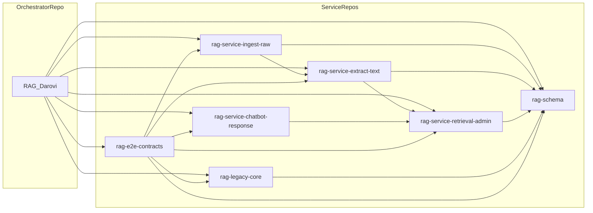

# RAG Darovi (Orchestrator)

This repository is the **local orchestrator** for the RAG Darovi platform. It does not host service code directly: every runtime lives in a dedicated repository and is mounted here through git submodules. The orchestrator owns Docker Compose, environment templates, integration scripts, and the verification gates that exercise the whole multi-repo system end to end.

For the second cleanup history and rationale, see [docs/repo-split/REPO_SPLIT_MAP.md](docs/repo-split/REPO_SPLIT_MAP.md) and [docs/repo-split/VERIFICATION_GATES.md](docs/repo-split/VERIFICATION_GATES.md).

## Repositories at a glance

- `services/ingest_raw` -> [Quantium/rag-service-ingest-raw](https://github.com/Quantium/rag-service-ingest-raw)
- `services/extract_text` -> [Quantium/rag-service-extract-text](https://github.com/Quantium/rag-service-extract-text)
- `services/retrieval_admin` -> [Quantium/rag-service-retrieval-admin](https://github.com/Quantium/rag-service-retrieval-admin)
- `services/chatbot_response` -> [Quantium/rag-service-chatbot-response](https://github.com/Quantium/rag-service-chatbot-response)
- `legacy/rag-legacy-core` -> [Quantium/rag-legacy-core](https://github.com/Quantium/rag-legacy-core)
- `schema/rag-schema` -> [Quantium/rag-schema](https://github.com/Quantium/rag-schema)
- `qa/rag-e2e-contracts` -> [Quantium/rag-e2e-contracts](https://github.com/Quantium/rag-e2e-contracts)

The legacy monolith image (`app-api`, `app-worker`, `app-worker-vision`, `app-beat`, `app-qa`) is built from the `legacy/rag-legacy-core` submodule.

## Standard relationship diagram



## Prerequisites

- Docker Engine and Docker Compose v2 (`docker compose`).
- Git (with submodule support).
- Roughly 10 GB free disk for images, volumes and Ollama models.
- OpenSSL if you generate local TLS certificates.
- Python 3.11+ only if you want to run service test gates locally; each repo bootstraps its own venv.

## First-time setup

```bash
git clone git@github.com:Quantium/RAG_Darovi.git
cd RAG_Darovi
git submodule update --init --recursive
cp .env.example .env
```

Edit `.env`. The file is gitignored.

## Update all submodules

Use this workflow whenever you want the orchestrator to point to the latest commits published in each sub-repository:

```bash
# 1) Sync URL metadata from .gitmodules
git submodule sync --recursive

# 2) Pull latest commits for every submodule tracking branch
git submodule update --init --recursive --remote

# 3) Review what changed
git submodule status
git status
```

If submodule pointers changed, commit them in the orchestrator:

```bash
git add .gitmodules services legacy schema qa
git commit -m "chore: update submodule pointers"
git push
```

## Run with Docker Compose

```bash
docker compose up -d --build
# or: make up
```

Published host ports:

| Port | Service |
|------|---------|
| 8000 | Legacy API + chat UI (`app-api`) |
| 8010 | Retrieval/admin API (`retrieval-admin-service`) |
| 8020 | Chatbot response API (`chatbot-response-service`) |
| 5432 | PostgreSQL |
| 6379 | Redis |
| 9000, 9001 | MinIO API and console |
| 19530 | Milvus |
| 11435 | Ollama |
| 11436 | Ollama Vision |

Smoke check:

```bash
docker compose ps
curl -fsS http://localhost:8000/status
curl -fsS http://localhost:8010/health
curl -fsS http://localhost:8020/health
./scripts/verify-multi-repo-local.sh
```

## Verification gates

| Target | What it does |
|--------|--------------|
| `make qa-legacy` | Run the legacy core unit suite from its submodule |
| `make qa-services` | Run the test suite of every service submodule |
| `make qa-cross` | Run cross-service contracts (`qa/rag-e2e-contracts`) |
| `make qa-all` | All of the above in order |

Each submodule provides its own Makefile. The orchestrator targets bootstrap a venv inside the submodule path and run the corresponding `pytest` suite.

## Makefile reference

| Target | Description |
|--------|-------------|
| `make up` | `docker compose up -d` |
| `make down` | `docker compose down` |
| `make submodules` | Sync and initialize all submodules |
| `make docker-build` | `docker compose build` |
| `make docker-qa` | Build and run `app-qa` (profile `qa`) |
| `make tls-certs` | Generate local TLS certificates under `./certs` |
| `make qa-legacy` | Run legacy core test gate |
| `make qa-services` | Run all service submodule test gates |
| `make qa-cross` | Run cross-service contract tests |
| `make qa-all` | Run legacy + services + cross gates |
| `make clean` | `docker compose down -v` and remove `__pycache__` |

## Rollback

A stable baseline tag (`v0.8.0`) was created before the multi-repo split. To return to it locally:

```bash
git fetch --tags
git checkout v0.8.0
git submodule sync --recursive
git submodule update --init --recursive
```

See [docs/repo-split/VERIFICATION_GATES.md](docs/repo-split/VERIFICATION_GATES.md) for full rollback guidance.

## HTTPS (optional)

Generate a self-signed cert for local HTTPS:

```bash
make tls-certs
```

Set in `.env`:

```env
API_SSL_CERTFILE=/etc/rag/certs/cert.pem
API_SSL_KEYFILE=/etc/rag/certs/key.pem
```

The `app-api` container mounts `./certs:/etc/rag/certs:ro`. The legacy entrypoint enables uvicorn TLS automatically when both files exist.

## FAQ

### `permission denied` when talking to Docker

Add your user to the `docker` group: `sudo usermod -aG docker "$USER"` and re-login, or prefix commands with `sudo`.

### Port 11434 already in use on the host

Compose maps the Ollama container to host port `11435` so a local Ollama install can keep `11434`. Pull models via the container, for example `docker compose exec ollama ollama pull nomic-embed-text`.

### Drive sync does nothing

Confirm the service account JSON, `DRIVE_FOLDER_ID`, and Drive API enablement. Mount `credentials/` into the relevant container.

### Where does service code live?

Inside each submodule. Browse, for example, [services/retrieval_admin/README.md](services/retrieval_admin/README.md), [legacy/rag-legacy-core/README.md](legacy/rag-legacy-core/README.md), or open the corresponding GitHub repo from the table above.
