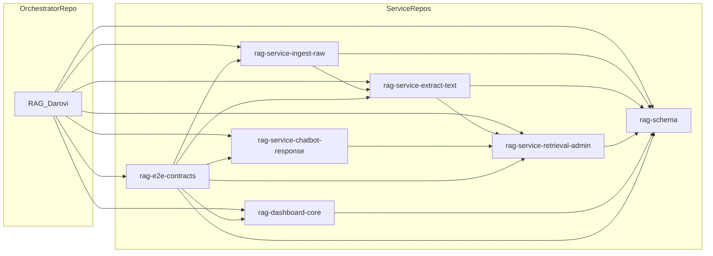

# rag-dashboard-core

Dashboard RAG monolith runtime extracted from the orchestrator repository as part of the multi-repo split.

## Scope

This repository owns the original FastAPI API + Celery worker stack that has not yet been migrated into a dedicated service repository:

- API layer (`src/api`)
- Celery workers and scheduler (`src/worker`, `src/scheduler`)
- RAG retrieval, vectorizer, converter, vision pipelines (`src/rag`, `src/vectorizer`, `src/converter`, `src/vision`)
- Local folder ingestion (`src/drive/local_downloader.py`)
- Generators and automations (`src/generator`, `src/automation`)
- Async + sync metadata repositories (`src/metadata`)
- Static dashboard chat UI (`static/`)
- Application configuration (`config/`)

It deliberately keeps the schema contract aligned with `rag-schema`. Do not change PostgreSQL schema here without coordinating with `rag-schema`.

## Repository relationships

- **Orchestrated by:** `Quantium/RAG_Darovi` (`dashboard/rag-dashboard-core` submodule path).
- **Schema source of truth:** `Quantium/rag-schema`.
- **Coexists with split services:** `Quantium/rag-service-ingest-raw`, `Quantium/rag-service-extract-text`, `Quantium/rag-service-retrieval-admin`, `Quantium/rag-service-chatbot-response` during migration phases.
- **Cross-service validation:** `Quantium/rag-e2e-contracts`.

## Layout

```
src/
config/
static/
tests/
Dockerfile
Dockerfile.dev
docker-entrypoint-api.sh
docker-healthcheck-api.sh
requirements.txt
requirements-dev.txt
pyproject.toml
```

## Local development

```bash
make install
make test
make lint
make typecheck
```

## Container image

`Dockerfile` is the production image (used by orchestrator's `dashboard-api`, `dashboard-worker`, `dashboard-beat`, `dashboard-worker-vision`).

`Dockerfile.dev` is the QA image used by `dashboard-qa` profile.

## Schema safety

Do not change database schema (`file_records` or related tables) without explicitly alerting the requester first and confirming migration impact. Schema lifecycle lives in `rag-schema`.



