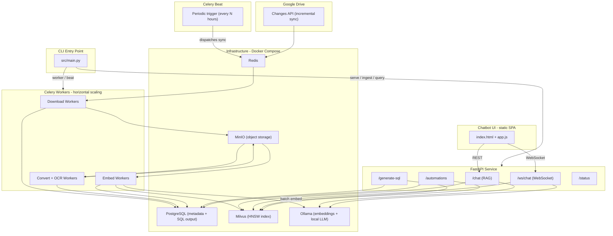

# RAG Pipeline Application — Plan Index

A terabyte-scale document ingestion, vectorization, and LLM-powered analysis pipeline.

## Prerequisites

The following must be installed on the host machine before starting Phase 1:

| Requirement | Version | Notes |
|---|---|---|
| Python | 3.11+ | Used for all application code and tests |
| Docker + Compose | v2+ | `docker compose` (not `docker-compose`) |
| Git | 2.x | Source control |
| ~10 GB free disk | — | Ollama models (~4 GB for `nomic-embed-text` + `llama3`), Docker images, Milvus data |

Optional for local development outside Docker:

- **Tesseract OCR** — needed only if running PDF conversion natively (installed inside Docker image by default).
- **Poppler** (`pdftotext`) — same as above.

## Phase Plans

Each plan is self-contained and must be executed **in order**. Every phase follows TDD and SOLID principles. Within each phase, steps that don't share data dependencies can be implemented in parallel (e.g., in Phase 3, storage and metadata modules are independent of each other).

| Phase | File | Description | Depends On |
|---|---|---|---|
| 1 | [PLAN_01_SETUP.md](PLAN_01_SETUP.md) | Virtual environment, dependencies, Docker infrastructure | — |
| 2 | [PLAN_02_TDD_TESTS.md](PLAN_02_TDD_TESTS.md) | Test infrastructure, conftest, and all test stubs (RED phase) | Phase 1 |
| 3 | [PLAN_03_DOWNLOAD_CONVERT.md](PLAN_03_DOWNLOAD_CONVERT.md) | Google Drive download and file conversion to text | Phase 2 |
| 4 | [PLAN_04_CRON_SYNC.md](PLAN_04_CRON_SYNC.md) | Celery workers, tasks, and scheduled incremental sync | Phase 3 |
| 5 | [PLAN_05_EMBEDDING.md](PLAN_05_EMBEDDING.md) | Batch embedding and vector storage in Milvus | Phase 4 |
| 6 | [PLAN_06_LLM.md](PLAN_06_LLM.md) | LLM client, retriever, SQL generator, and automation engine | Phase 5 |
| 7 | [PLAN_07_UI_CHATBOT.md](PLAN_07_UI_CHATBOT.md) | FastAPI + chatbot UI with document references | Phase 6 |

## Architecture



### Data Flow — Document Lifecycle

1. **First run**: `full_sync()` scans all files in the configured Drive folder via `files.list` and acquires the initial `startPageToken`. **Subsequent runs**: `incremental_sync()` uses `changes.list` to detect changed and deleted files.
2. Changed files are downloaded to **MinIO** (raw bucket) and a metadata record is created in **PostgreSQL** with `pending` status. Deleted files trigger a `delete_file_vectors` task that removes vectors from Milvus, objects from MinIO, and metadata from PostgreSQL.
3. Each file is converted to plain text — PDFs via `pdfplumber` + Tesseract OCR fallback, Google Docs/Sheets via Drive export, `.docx`/`.xlsx` via `python-docx`/`openpyxl`, HTML via `BeautifulSoup` — and the text is stored back in MinIO (text bucket). Unsupported MIME types are skipped with a warning.
4. Text is split into semantic chunks (heading-aware, max 512 tokens via `tiktoken`, 50-token overlap), embedded in batches via **Ollama** (`nomic-embed-text`, 768-dim), and upserted into **Milvus** with HNSW indexing.
5. Users query the chatbot UI (or REST/CLI); the **Retriever** embeds the query, searches Milvus for relevant chunks, and the **LLM** generates an answer with inline source citations. Multi-turn conversation context is maintained via Redis-backed conversation memory.

## Tech Stack

- **Language**: Python 3.11
- **Google Drive**: `google-api-python-client`, `google-auth` (Service Account JSON), `full_sync()` for initial bootstrap + `incremental_sync()` via `changes.list` API (with file deletion detection)
- **OCR**: `pytesseract` + `pdf2image` (Tesseract in Docker)
- **PDF text**: `pdfplumber`
- **Additional formats**: `python-docx` (.docx), `openpyxl` (.xlsx), `beautifulsoup4` + `markdown` (HTML/Markdown)
- **Tokenization**: `tiktoken` (`cl100k_base`) for accurate chunk token counting
- **Embeddings**: Ollama API (`nomic-embed-text`, 768-dim), batch embedding via `/api/embed`
- **Vector DB**: Milvus with HNSW index, partitioned by document source/type
- **LLM**: OpenAI-compatible client supporting Gemini, DeepSeek, and Ollama
- **Task queue**: Celery + Redis (isolated DBs: broker=0, results=1, cache=2) for parallel worker processing
- **Metadata DB**: PostgreSQL (async via `asyncpg` for FastAPI, sync via `psycopg2` for Celery tasks)
- **SQL output**: SQLAlchemy — LLM-generated SQL runs in isolated `generated` schema via restricted `rag_generator` DB user
- **Sheets output**: `gspread` (uses separate `spreadsheets` scope, not `drive.readonly`)
- **Object storage**: MinIO for raw files and converted text
- **API**: FastAPI + uvicorn (REST + WebSocket chat) with optional API key authentication
- **Conversation memory**: Redis-backed multi-turn history store
- **Scheduler**: Celery Beat (24h interval) with distributed Redis lock to prevent concurrent syncs
- **Orchestration**: Docker Compose
- **Logging**: `structlog` for structured observability
- **Testing**: pytest + unittest.mock

## Key Architecture Decisions

| Decision | Rationale |
|---|---|
| **Milvus** over Pinecone / ChromaDB | Self-hosted (no vendor lock-in), native HNSW index, partition support for filtering by document type, scales horizontally for terabyte-scale data. |
| **Ollama** for embeddings + local LLM | Zero-cost inference, data never leaves the network (privacy), works offline, swappable to cloud providers via OpenAI-compatible interface. |
| **Celery + Redis** over pure asyncio | Built-in retry logic, separate queues for download/convert/embed allow independent horizontal scaling, Beat scheduler for cron, task visibility via Flower. |
| **MinIO** over local filesystem | S3-compatible API (portable to AWS/GCP later), Docker-native, supports concurrent access from multiple workers, bucket-level separation of raw vs. converted files. |
| **OpenAI-compatible LLM interface** | All three providers (Ollama, Gemini, DeepSeek) expose the same chat completions API, enabling provider swaps via a single env var (`LLM_PROVIDER`) with no code change. |
| **Pydantic Settings** for config | Single source of truth, type-safe, reads from `.env` with sensible defaults, validated at startup — errors surface immediately instead of at runtime. |
| **PostgreSQL** for metadata (not SQLite) | Async support via `asyncpg`, concurrent writes from multiple Celery workers, UPSERT support, same DB used for SQL generation output — avoids managing two engines. |
| **Sync DB sessions for Celery** | `AsyncSession` is bound to the event loop that created it. Celery tasks are synchronous — using `asyncio.run()` to bridge async sessions caused cross-event-loop issues. Celery tasks use `psycopg2` + synchronous `Session`; FastAPI uses `asyncpg` + `AsyncSession`. |
| **Redis DB isolation** | Broker (DB 0), result backend (DB 1), and cache/conversation (DB 2) use separate Redis databases. Prevents cache eviction from affecting task delivery and provides clear operational boundaries. |
| **Separate Drive scopes** | Drive download uses `drive.readonly`; Sheets writing uses `spreadsheets` scope. Same service-account JSON can be used, but each client requests only the scopes it needs — principle of least privilege. |
| **SQL safety layers** | LLM-generated SQL is validated (whitelist + forbidden pattern regex), executed by a restricted DB user (`rag_generator`) with only `INSERT`/`CREATE TABLE` on the `generated` schema. Defense in depth against prompt injection via document content. |
| **API key auth** | Optional `X-API-Key` header. When `API_KEY` env var is empty, auth is disabled (dev mode). Prevents unauthorized access to query, SQL generation, and automation endpoints in production. |
| **Distributed sync lock** | Redis `SET NX` with TTL prevents overlapping `incremental_sync` runs from Beat, manual triggers, or multiple Beat instances. |
| **Initial bootstrap via `full_sync`** | `changes.list` only returns changes after a token is acquired. On first run, `full_sync()` uses `files.list` to discover all existing files, then acquires the initial `startPageToken`. |

## Project Structure

```
RAG_Darovi_test/
├── docker-compose.yml
├── Dockerfile
├── pyproject.toml                # pytest, ruff, mypy config
├── requirements.txt
├── .env.example
├── .gitignore
├── plans/                        # Phase plan files (this directory)
├── config/
│   └── settings.py               # Pydantic Settings, reads .env
├── src/
│   ├── __init__.py
│   ├── main.py                   # CLI entry point (serve, ingest, query, worker, beat)
│   ├── drive/
│   │   ├── __init__.py
│   │   ├── auth.py               # build_drive_service()
│   │   └── downloader.py         # Incremental sync via changes.list
│   ├── storage/
│   │   ├── __init__.py
│   │   └── backend.py            # MinIO / local fallback
│   ├── converter/
│   │   ├── __init__.py           # Converter factory (get_converter)
│   │   ├── base.py               # FileConverter protocol
│   │   ├── pdf_converter.py      # pdfplumber + Tesseract OCR
│   │   ├── docs_converter.py     # Google Docs → plain text
│   │   ├── sheets_converter.py   # Google Sheets → CSV (multi-sheet)
│   │   ├── docx_converter.py     # Microsoft Word .docx via python-docx
│   │   ├── xlsx_converter.py     # Microsoft Excel .xlsx via openpyxl
│   │   └── text_converter.py     # text/plain, text/markdown, text/html
│   ├── vectorizer/
│   │   ├── __init__.py
│   │   ├── chunker.py            # Document-aware chunking
│   │   ├── embedder.py           # Batch embed via Ollama
│   │   └── milvus_store.py       # HNSW collection + partitions
│   ├── metadata/
│   │   ├── __init__.py
│   │   └── repository.py         # Processing state in PostgreSQL
│   ├── worker/
│   │   ├── __init__.py
│   │   ├── celery_app.py         # Celery configuration + RetryableTask
│   │   └── tasks.py              # download, convert, embed tasks
│   ├── rag/
│   │   ├── __init__.py
│   │   ├── retriever.py          # Semantic search + Redis cache
│   │   ├── llm_client.py         # OpenAI-compatible (Ollama / Gemini / DeepSeek)
│   │   ├── conversation.py       # Redis-backed multi-turn conversation memory
│   │   └── chain.py              # rag_answer() + rag_answer_stream() with history
│   ├── generator/
│   │   ├── __init__.py
│   │   ├── sql_generator.py      # Schema discovery + SQL extraction
│   │   ├── db_writer.py          # Execute SQL
│   │   └── sheets_writer.py      # Write to Google Sheets
│   ├── automation/
│   │   ├── __init__.py
│   │   ├── engine.py             # Automation runner
│   │   └── templates.py          # YAML automation definitions
│   ├── api/
│   │   ├── __init__.py
│   │   ├── app.py                # FastAPI factory
│   │   ├── routes.py             # REST + WebSocket endpoints
│   │   └── schemas.py            # Pydantic request/response models
│   └── scheduler/
│       ├── __init__.py
│       └── pipeline.py           # Celery Beat periodic sync
├── static/                       # Chatbot SPA served by FastAPI
│   ├── index.html
│   ├── styles.css
│   └── app.js
├── tests/
│   ├── __init__.py
│   ├── conftest.py
│   ├── test_config/
│   ├── test_drive/
│   ├── test_storage/
│   ├── test_converter/
│   ├── test_vectorizer/
│   ├── test_metadata/
│   ├── test_worker/
│   ├── test_scheduler/
│   ├── test_rag/
│   ├── test_generator/
│   ├── test_automation/
│   └── test_api/
└── credentials/                  # gitignored
```

## Shared Principles (All Phases)

### SOLID

- **Single Responsibility**: Each module owns exactly one concern.
- **Open/Closed**: `FileConverter` protocol allows adding new file types without modifying existing converters.
- **Liskov Substitution**: All converters are interchangeable behind the `FileConverter` protocol.
- **Interface Segregation**: Storage, LLM, and DB interfaces expose minimal surfaces.
- **Dependency Inversion**: Modules depend on abstractions (protocols), not concrete implementations.

### TDD Workflow

1. **RED** — Write failing tests for the module's contract (Phase 2).
2. **GREEN** — Implement the minimum code to pass tests (Phases 3–7).
3. **REFACTOR** — Clean up while keeping tests green.

### Configuration Strategy

All modules read configuration from a single `Settings` instance (`config/settings.py`), which loads values from `.env` via Pydantic Settings. Override chain: **environment variables > `.env` file > code defaults**. No module reads `os.environ` directly — always inject `Settings`.

### Quality Standards

- **Strict Typing**: Python 3.11+ type hints on all public functions.
- **Pydantic Validation**: All config and API schemas.
- **Linting & Formatting**: `ruff check` + `ruff format` + `mypy`.
- **Async I/O**: `async/await` for all I/O-bound operations.
- **Structured Logging**: `structlog` with `request_id`, `file_id`, `task_name`.
- **Graceful Failure**: Exponential backoff retries (max 5), circuit breakers for external APIs.

### LLM Implementation Guidelines

1. **Contract-First**: Define a `Protocol` or Pydantic model before writing any logic. See Phase 6 for the full `LLMClient` protocol, provider factory, and RAG chain details.
2. **Success Criteria**: Every step must satisfy its SC before moving on — never skip a failing test to start the next step.

## Definition of Done

The project is complete when **all** of the following are true:

- [ ] `pytest -v` passes 100% across all modules (no skipped, no xfail).
- [ ] `mypy --strict src/` reports zero errors.
- [ ] `ruff check src/ tests/` and `ruff format --check src/ tests/` report zero issues.
- [ ] `docker compose up -d` starts all services healthy (Redis, PostgreSQL, Milvus, MinIO, Ollama, app-api, app-worker, app-beat).
- [ ] First run performs a full scan of existing Drive files; subsequent runs use incremental sync.
- [ ] Celery Beat triggers automatic incremental sync on the configured schedule (with distributed lock preventing concurrent runs).
- [ ] Deleted files in Drive are detected and their vectors, MinIO objects, and metadata are cleaned up automatically.
- [ ] The chatbot UI at `http://localhost:8000` accepts queries, streams answers via WebSocket, displays source references, and maintains multi-turn conversation context.
- [ ] API endpoints require `X-API-Key` header when `API_KEY` is configured.
- [ ] LLM-generated SQL passes whitelist validation and executes under a restricted DB user on an isolated schema.
- [ ] `GET /status` returns accurate pipeline progress counts.
- [ ] A document modified in Google Drive is automatically re-downloaded, re-converted, and re-indexed without stale vectors remaining in Milvus.
