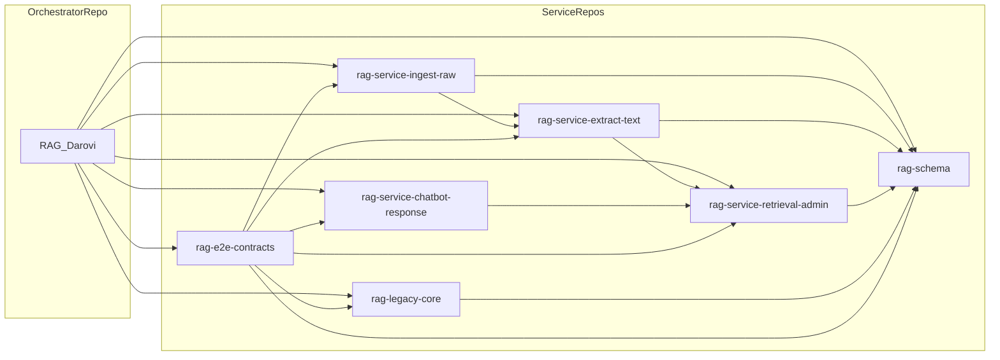

# chatbot_response service

Standalone chatbot response service for RAG Darovi.

## Scope

- Exposes `POST /chat` and `WS /ws/chat`.
- Uses Redis conversation memory locally in this service.
- Calls `retrieval_admin` over HTTP to retrieve context.
- Owns a very simple chat-only frontend.

## Endpoints

- `GET /health`
- `POST /chat`
- `WS /ws/chat`

## Configuración

Todos los parámetros se leen de variables de entorno (`.env` raíz del orquestador, inyectadas por docker-compose). No hay valores hardcodeados en el código.

### Conexiones

| Variable | Default | Descripción |
|---|---|---|
| `API_PORT` | `8020` | Puerto HTTP del servicio |
| `RETRIEVAL_ADMIN_BASE_URL` | `http://retrieval-admin-service:8010` | URL del servicio de retrieval |
| `REDIS_CACHE_URL` | `redis://redis:6379/2` | Redis para historial de conversación |
| `CONVERSATION_TTL_SECONDS` | `86400` | TTL del historial (segundos) |

### Modelo LLM

| Variable | Default | Descripción |
|---|---|---|
| `LLM_PROVIDER` | `deepseek` | Proveedor (cualquier API compatible con OpenAI) |
| `LLM_MODEL` | `deepseek-chat` | Nombre del modelo |
| `LLM_BASE_URL` | `https://api.deepseek.com/v1/` | URL base OpenAI-compatible |
| `LLM_API_KEY` | _(vacío)_ | API key (fallback; use `DEEPSEEK_API_KEY` preferentemente) |
| `DEEPSEEK_API_KEY` | _(vacío)_ | API key de DeepSeek (tiene precedencia sobre `LLM_API_KEY`) |

El servicio usa el cliente `openai.AsyncOpenAI` apuntando a la URL configurada.

### Parámetros de generación

Controlan la calidad y determinismo de las respuestas del LLM.

| Variable | Default | Descripción |
|---|---|---|
| `LLM_TEMPERATURE` | `0.1` | Creatividad del modelo. 0 = determinístico, 1 = creativo. Valor bajo recomendado para datos factuales. |
| `LLM_TOP_P` | `0.95` | Nucleus sampling: considera solo los tokens cuya probabilidad acumulada alcanza este valor. |
| `LLM_FREQUENCY_PENALTY` | `0.2` | Penaliza tokens que ya aparecieron en la respuesta, reduciendo repetición (OpenAI/DeepSeek). |
| `LLM_REPEAT_PENALTY` | `1.1` | _(deprecated, ignorado)_ |
| `LLM_MAX_TOKENS` | `2048` | Máximo de tokens en la respuesta generada. |

### Parámetros de retrieval y contexto

Controlan cuánta información se recupera de Milvus y cuánta llega al LLM.

| Variable | Default | Descripción |
|---|---|---|
| `LLM_MAX_CONTEXT_CHARS` | `32000` | Caracteres máximos del contexto RAG enviados al LLM. Para preguntas específicas se usa la mitad (`/ 2`). |
| `RETRIEVAL_TOP_K_DEFAULT` | `10` | Chunks recuperados de Milvus para consultas específicas (ej. "¿qué es el Ibuprofeno?"). El retriever devuelve hasta `top_k × 2` tras incluir resultados por keyword. |
| `RETRIEVAL_TOP_K_AGGREGATE` | `40` | Chunks recuperados para consultas de conteo o listado (ej. "¿cuántos medicamentos hay?", "lista todos"). Se activa automáticamente al detectar palabras clave como *cuántos*, *lista*, *todos*, *enumera*, *total de*, etc. |

> **Por qué importa `LLM_MAX_CONTEXT_CHARS`:** cada chunk de OCR puede pesar ~500–1000 caracteres. Con el valor original de 6,000 solo llegaban ~6 chunks al LLM aunque el retriever trajera 20; la mayoría de documentos nunca se veían. Con 32,000 caben ~30–50 chunks, suficientes para responder preguntas globales sobre toda la base.

## Run standalone

```bash
cd services/chatbot_response
python3 -m venv .venv
source .venv/bin/activate
pip install -r requirements.txt
python main.py
```

## Run with Docker

```bash
cd services/chatbot_response
docker build -t chatbot-response-service .
docker run --rm -p 8020:8020 chatbot-response-service
```

## Contract

Dependency contract with retrieval service:

- [`API_CONTRACT.md`](API_CONTRACT.md)

## Repository relationships

- **Orchestrated by:** `Quantium/RAG_Darovi` (`services/chatbot_response` submodule path).
- **Retrieval dependency:** `Quantium/rag-service-retrieval-admin` (`POST /retrieve` contract).
- **Data freshness upstream:** indirectly depends on `Quantium/rag-service-ingest-raw` and `Quantium/rag-service-extract-text` pipelines, but can answer when those are offline if retrieval data already exists.
- **Schema governance dependency:** `Quantium/rag-schema` (indirect through retrieval/metadata stack).
- **Cross-service validation:** `Quantium/rag-e2e-contracts`.

## Standard relationship diagram



## Schema safety

Do not change database schema (`file_records` or related tables) without explicitly alerting the requester first and confirming migration impact.

## Expected tangible output

- `POST /chat` and `WS /ws/chat` generate answers using retrieval context from `retrieval_admin`.
- The service remains functional even when `ingest_raw` and `extract_text` are offline, as long as retrieval and model dependencies are reachable.
- Conversation history is persisted in Redis per `conversation_id`.
