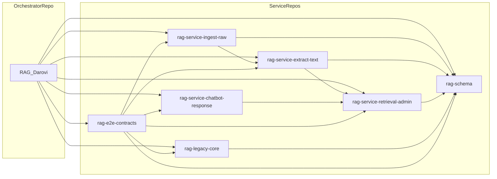

# extract_text service

Independent text extraction service for RAG Darovi. This project runs as its own container and has no import dependency on `src/` from the main application.

## Purpose

- Poll PostgreSQL metadata for RAW changes.
- Ensure singleton execution (one extraction run at a time) using PostgreSQL advisory locks.
- Download changed RAW objects from MinIO.
- Extract normalized Markdown by MIME type.
- Upload Markdown artifacts to MinIO TEXT bucket.
- Update text stage metadata (`text_source_checksum`, `text_checksum`, `text_status`, `text_extracted_at`).

## Relationship with the main project

- Upstream RAW ingestion is handled by `services/ingest_raw`.
- This service prepares records with `text_status=ready_for_embedding`.
- Existing workers in the main app poll PostgreSQL and continue downstream vision/embedding stages.

See root architecture context in [`../../README.md`](../../README.md).

## Repository relationships

- **Orchestrated by:** `Quantium/RAG_Darovi` (`services/extract_text` submodule path).
- **Schema source of truth:** `Quantium/rag-schema` (shared `file_records` contract).
- **Upstream stage:** `Quantium/rag-service-ingest-raw` provides RAW objects and metadata transitions.
- **Downstream stage:** text artifacts are consumed by embedding/retrieval flows (`Quantium/rag-service-retrieval-admin` and legacy pipeline where enabled).
- **Cross-service validation:** `Quantium/rag-e2e-contracts`.

## Standard relationship diagram



## Folder structure

- `main.py`: process entrypoint.
- `app/settings.py`: service settings.
- `app/db.py`: PostgreSQL metadata access + advisory lock handling.
- `app/storage.py`: MinIO RAW/TEXT operations.
- `app/extractors.py`: MIME-specific text extraction helpers.
- `app/service.py`: extraction orchestration.
- `app/cron_runner.py`: internal cron loop.

## Configuration

This service reads environment variables via Pydantic settings (`app/settings.py`).

Key variables:

- `DATABASE_URL_SYNC`
- `MINIO_ENDPOINT`
- `MINIO_ACCESS_KEY`
- `MINIO_SECRET_KEY`
- `MINIO_BUCKET_RAW`
- `MINIO_BUCKET_TEXT`
- `EXTRACT_TEXT_CRON` (default: `0 */4 * * *`)
- `EXTRACT_TEXT_BATCH_SIZE` (default: `200`)
- `EXTRACT_TEXT_RUN_ON_START` (default: `true`)
- `EXTRACT_TEXT_LOCK_ID` (advisory lock key, default: `8245101`)

## Run standalone (local)

```bash
cd services/extract_text
python3 -m venv .venv
source .venv/bin/activate
pip install -r requirements.txt
python main.py
```

## Run with Docker Compose

Use the root Compose stack, which already defines `extract-text-service`:

```bash
cd ../../
docker compose up -d --build extract-text-service
```

## Operational notes

- Change detection is metadata-driven using RAW checksum vs text source checksum.
- Locking prevents concurrent extraction runs.
- Failures are tracked per file in PostgreSQL (`text_status=failed`, `text_error`), without aborting the full batch.
- Do not change the database schema used by this service without explicitly alerting the requester first and confirming migration impact.

## Expected tangible output

- For rows with `raw_status='synced'`, this service writes `drive_file_id.md` to MinIO TEXT.
- `file_records` updates `minio_text_key`, `text_source_checksum`, `text_checksum`, and `text_status='ready_for_embedding'`.
- The service can be validated with only Postgres + MinIO running.
