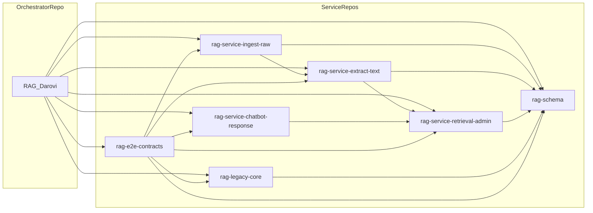

# ingest_raw service

Independent RAW ingestion service for RAG Darovi. This project runs as its own container and has no import dependency on `src/` from the main application.

## Purpose

- Poll a local document folder on a cron schedule.
- Detect source changes using PostgreSQL metadata (`file_records` stage fields).
- Upload changed binaries to MinIO RAW bucket.
- Update RAW stage metadata (`raw_source_version`, `raw_checksum`, `raw_status`, `raw_synced_at`).

## Relationship with the main project

- Upstream source sync responsibility lives here.
- Downstream text extraction is handled by `services/extract_text`.
- Existing worker pipeline in the main app continues after text is ready.

See root architecture context in [`../../README.md`](../../README.md).

## Repository relationships

- **Orchestrated by:** `Quantium/RAG_Darovi` (`services/ingest_raw` submodule path).
- **Schema source of truth:** `Quantium/rag-schema` (shared `file_records` contract).
- **Downstream stage:** `Quantium/rag-service-extract-text` consumes RAW metadata/object outputs.
- **Downstream consumers after extraction:** `Quantium/rag-service-retrieval-admin` and `Quantium/rag-service-chatbot-response` (indirectly through retrieval availability).
- **Cross-service validation:** `Quantium/rag-e2e-contracts`.

## Standard relationship diagram



## Folder structure

- `main.py`: process entrypoint.
- `app/settings.py`: service settings.
- `app/sources.py`: Local folder adapter.
- `app/storage.py`: MinIO RAW operations.
- `app/db.py`: PostgreSQL metadata access.
- `app/service.py`: ingestion orchestration.
- `app/cron_runner.py`: internal cron loop.

## Configuration

This service reads environment variables via Pydantic settings (`app/settings.py`).

Key variables:

- `LOCAL_SOURCE_FOLDER`
- `DATABASE_URL_SYNC`
- `MINIO_ENDPOINT`
- `MINIO_ACCESS_KEY`
- `MINIO_SECRET_KEY`
- `MINIO_BUCKET_RAW`
- `INGEST_RAW_CRON` (default: `0 * * * *`)
- `INGEST_RAW_BATCH_SIZE` (default: `200`)
- `INGEST_RAW_RUN_ON_START` (default: `true`)

## Run standalone (local)

```bash
cd services/ingest_raw
python3 -m venv .venv
source .venv/bin/activate
pip install -r requirements.txt
python main.py
```

## Run with Docker Compose

Use the root Compose stack, which already defines `ingest-raw-service`:

```bash
cd ../../
docker compose up -d --build ingest-raw-service
```

## Operational notes

- Change detection is metadata-driven (PostgreSQL), not file listing only.
- Runs can be idempotent when source version/checksum did not change.
- On successful RAW sync, text stage is marked pending for extraction service pickup.
- Do not change the database schema used by this service without explicitly alerting the requester first and confirming migration impact.

## Expected tangible output

- In local mode, changed files from `LOCAL_SOURCE_FOLDER` are uploaded to MinIO RAW.
- `file_records` rows update `raw_source_version`, `raw_checksum`, `raw_status='synced'`, and `raw_synced_at`.
- You can validate results directly from PostgreSQL and MinIO without running any other service besides Postgres + MinIO.
