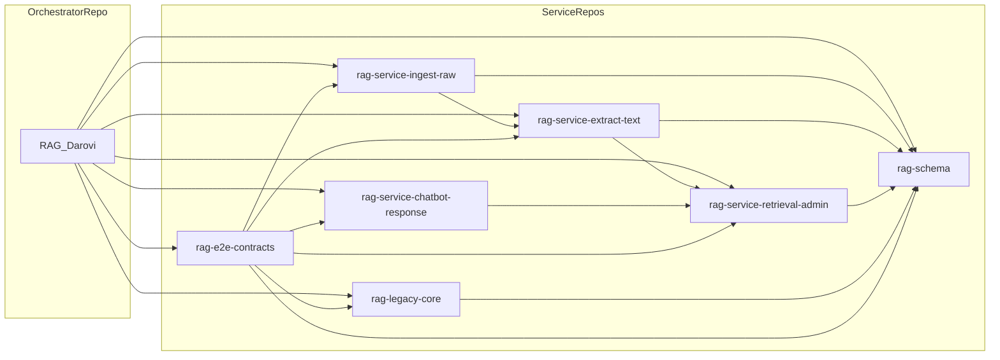

# retrieval_admin service

Standalone Retrieval/Admin service for RAG Darovi.

## Scope

- Exposes retrieval/context API (`POST /retrieve`) for downstream chatbot service.
- Exposes simplified operational endpoints (`/status`, `/status/files`, `/status/raw-data`).
- Owns its own runtime package layout and container image.

## Endpoints

- `GET /health`
- `POST /retrieve`
- `POST /answer` (utility LLM endpoint)
- `GET /status`
- `GET /status/files`
- `GET /status/raw-data`

## Run standalone

```bash
cd services/retrieval_admin
python3 -m venv .venv
source .venv/bin/activate
pip install -r requirements.txt
python main.py
```

## Run with Docker

```bash
cd services/retrieval_admin
docker build -t retrieval-admin-service .
docker run --rm -p 8010:8010 retrieval-admin-service
```

## Contract

Boundary contract consumed by `chatbot_response`:

- [`API_CONTRACT.md`](API_CONTRACT.md)

## Repository relationships

- **Orchestrated by:** `Quantium/RAG_Darovi` (`services/retrieval_admin` submodule path).
- **Schema source of truth:** `Quantium/rag-schema` (metadata tables consumed by status/retrieval endpoints).
- **Upstream data production:** `Quantium/rag-service-ingest-raw` and `Quantium/rag-service-extract-text` (plus legacy embedding pipeline where enabled).
- **Primary downstream consumer:** `Quantium/rag-service-chatbot-response` via `/retrieve` contract.
- **Cross-service validation:** `Quantium/rag-e2e-contracts`.

## Standard relationship diagram



## Schema safety

Do not change database schema (`file_records` or related tables) without explicitly alerting the requester first and confirming migration impact.

## Expected tangible output

- `POST /retrieve` returns context and source references from indexed chunks.
- `GET /status` and status endpoints reflect processing state from PostgreSQL and storage dependencies.
- The service can run and be tested independently from ingestion/extraction services.
